# Remote Deck // High-Performance Workstation Control Deck

> Ultra-low-latency, sleek LAN remote control system for Windows workstations driven from an Android / iOS device. Built with a native **Go Win32 Agent**, **Tauri Desktop Control Center**, and an **Expo React Native** mobile client.

---

## ⚡ Architecture Overview

```mermaid
graph LR
    subgraph Mobile ["📱 Mobile Client (Expo / React Native)"]
        Trackpad["Kinetic Trackpad & Air Mouse"]
        Soundboard["Master Audio & Tactical TV Remote"]
        StreamDeck["Macro Deck & App Launcher"]
        Telemetry["Telemetry & Task Killer"]
        FileDrop["LAN File Beam (AirDrop)"]
    end

    subgraph Transport ["⚡ Local LAN Transport"]
        WS["WebSocket (Full-Duplex Stream)"]
        HTTP["HTTP / REST (File Drops & QR Auth)"]
        mDNS["Zero-Config Discovery"]
    end

    subgraph Host ["🖥️ Windows Workstation (Go Agent)"]
        Win32["Win32 Input Injector (SendInput)"]
        WASAPI["Core Audio Direct (WASAPI)"]
        Pdh["Hardware Counters (Pdh / WMI)"]
        Proc["Process Terminator (OpenProcess)"]
        FS["Downloads Storage (%USERPROFILE%)"]
    end

    Mobile <===> Transport <===> Host
```



---

## 🎮 Key Features & Capabilities

### 1. Kinetic Trackpad & Gyroscopic Air Mouse
* **Precision Trackpad:** Native-driven touch surface with pointer acceleration, single-finger tap-to-click, and press-and-hold dragging.
* **120-Unit Windows Wheel Scrolling:** Two-finger scroll engine that accumulates fractional gestures and emits whole `WHEEL_DELTA` (120-unit) notches, preventing dropped ticks or stutter in Windows applications.
* **Gyroscopic Air Mouse:** 40Hz IMU motion tracking powered by `expo-sensors`. Tilt and point your phone like a laser pointer with hardware deadzone filtering to eliminate hand tremors.
* **Bidirectional Clipboard Sync:** One-tap clipboard transfer between phone and PC via native `expo-clipboard` and Win32 clipboard APIs.

### 2. Master Audio Bus & Tactical TV Remote
* **Soundboard Master Fader:** Vertical analog-style mixer panel with real-time level feedback in dBFS.
* **Hardware-Accelerated VU Meters:** Multi-channel stereo dancing VU meters decoupled from the main thread for smooth 60fps rendering without re-render overhead.
* **Tactical TV Remote D-Pad:** 5-way circular directional controller (`UP`, `DOWN`, `LEFT`, `RIGHT`, `OK`) sending Windows virtual keys (`VK_UP`, `VK_DOWN`, `VK_LEFT`, `VK_RIGHT`, `VK_RETURN`) for leanback control in VLC, YouTube, Netflix, Kodi, and Steam Big Picture.
* **10s Seek Mode:** Dedicated scrub controls toggleable between Web/YouTube (`J` / `L`) and native media players (arrow keys).

### 3. Stream Deck / Macro Grid
* **One-Tap App Launchers:** Single-tap execution for Google Chrome, Spotify, Visual Studio Code, Windows Terminal, Task Manager, and Calculator.
* **System Hotkey Chords:** Instant triggers for `Win + D` (Show Desktop), `Win + Shift + S` (Snipping Tool), `Alt + Tab` (Task Switcher), `Alt + F4` (Close Active Window), `F11` (Fullscreen), and `F5` (Refresh).

### 4. Active Workload Matrix & Task Killer
* **Live Hardware Telemetry:** Real-time CPU, RAM, and storage utilization gauges.
* **Process Monitor & Task Killer:** Live matrix of top active Windows tasks with instantaneous one-tap process termination (`OpenProcess` + `TerminateProcess`) to kill frozen games or hung applications directly from your phone.

### 5. Local LAN File Beam (AirDrop for Windows)
* **Direct File Drop:** Beam photos, documents, and videos directly from the mobile file picker into the PC's `%USERPROFILE%\Downloads` folder over local Wi-Fi without third-party cloud services.

### 6. Tactical Security & Hardware Auth
* **Biometric Authentication Guard:** Requires Fingerprint / Face ID via `expo-local-authentication` before executing destructive power commands (Shutdown, Restart, Hibernate).
* **Wake-on-LAN (WoL):** Broadcasts standard UDP Magic Packets (`FF:FF:FF:FF:FF:FF` + 16 MAC repetitions) to wake sleeping workstations across the LAN.
* **ECDH & Dynamic PIN Pairing:** Zero-trust pairing flow utilizing dynamic QR codes and PIN verification stored in the phone's Secure Enclave (`expo-secure-store`).
* **Tactile Haptic Engine:** Physical vibration tick feedback for volume notches, button triggers, and trackpad clicks via `expo-haptics`.

---

## 📂 Repository Structure

| Path | Purpose |
| :--- | :--- |
| `agent/windows/` | High-performance Go background agent for Windows (`Win32`, `WASAPI`, `Pdh`, `WebSocket`, `SQLite`). |
| `app/` | Cyberpunk-themed mobile client built with Expo (React Native SDK 58, Expo Router, Reanimated). |
| `design/` | Visual source of truth and design tokens (`Obsidian #0B0E14`, `Electric Citrus #CAF300`, `Cyan #38BDF8`). |

---

## 🚀 Quick Start Guide

### 1. Start the Windows Agent

```powershell
cd agent/windows

# Build the native Go agent executable
.\scripts\build.ps1

# Run the agent (defaults to port 8765)
.\bin\remotedeck-agent.exe

# To run tests & validation:
.\scripts\test.ps1
```

### 2. Start the Mobile Client

```bash
cd app

# Install dependencies
npm install

# Start the Expo development server
npx expo start

# Open on Android device or scan the QR code using Expo Go (SDK 58)
npx expo start --android
```

---

## 🧪 Verification & Quality Gates

Run all automated verification gates before pushing code:

```bash
# Frontend Verification (from /app)
npx tsc --noEmit           # TypeScript type check (0 errors)
npm test                   # Jest unit test suite (4 suites, 40 tests)
npx expo lint              # ESLint code hygiene

# Backend Verification (from /agent/windows)
go test ./...              # Go unit test suite across all 18 modules
go vet ./...               # Static analysis
```

---

## 🔒 Security Architecture

* **Local Subnet Isolation:** Agent binds to local LAN interfaces with loopback bypass for host users.
* **Encrypted Sessions:** Hardware-backed Keystore (`expo-secure-store`) token storage.
* **Safe Process Termination:** Process kill commands strictly validate PID existence and require explicit user-initiated triggers.
* **Biometric Power Locks:** Prevents accidental or unauthorized workstation shutdowns.

---

## 📄 License
MIT License. Built for seamless workstation control.
